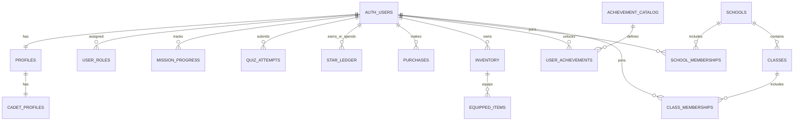

# Backend data model

**Status:** Proposed schema, represented by `supabase/migrations/202611150001_initial_schema.sql`. No live student data is present.

## Design rules

- `auth.users.id` is the identity key. Never accept a user ID from a request as proof of identity; derive it from the verified access token.
- Do not store passwords, password hashes, date of birth, home address, precise location, or unnecessary personal information in application tables.
- Public display names are aliases, not email addresses. Leaderboard participation is opt-in.
- Scores, rewards, roles, inventory ownership and purchases are server-authoritative. The browser may send answers or an item ID, but not an authoritative score, star balance, price, role or ownership flag.
- Mission and cosmetic catalogues are versioned application content. The server validates submitted IDs against its trusted catalogue/version before granting anything.
- Keep quiz answers out of long-term storage by default. Store score, maximum score and grading version; retain answer detail only if a teacher-approved learning purpose requires it.
- School and teacher entities are optional and must remain unused until the school approves the data model and access policy.

## Entity relationships

## Tables

| Table | Purpose | Important rules |
|---|---|---|
| `profiles` | Minimal user-facing profile | `id` references Auth; display name and optional public handle; leaderboard opt-in defaults false |
| `cadet_profiles` | Game-specific cadet name, avatar and locale | One row per user; cannot assign roles here |
| `user_roles` | Trusted `admin` / `teacher` assignments | No client read/write grants; changed only by a trusted operator/server process |
| `mission_progress` | Current mission state, best score, attempts and checkpoint | Server writes only; unique `(user_id, mission_key)`; score bounded by max score |
| `quiz_attempts` | Immutable result record for each attempt | Server calculates score; client cannot insert or edit result rows |
| `achievement_catalog` | Trusted achievement definitions | Read-only catalogue |
| `user_achievements` | Achievement unlocks | Server grants; unique `(user_id, achievement_key)` |
| `star_ledger` | Append-only earned/spent star events | Positive/negative delta; unique event key prevents duplicate rewards; balance is derived, never client-set |
| `cosmetic_catalog` | Trusted item IDs, slots and prices | Server-controlled prices and active status |
| `purchases` | Virtual-currency purchase records | Server validates item, price, balance and idempotency key in one transaction |
| `inventory` | Items owned by a cadet | Server inserts; unique item ownership per user |
| `equipped_items` | Current item per cosmetic slot | Server validates item ownership and slot compatibility |
| `schools`, `school_memberships` | Optional school membership | Disabled until approved; school-scoped reads only |
| `classes`, `class_memberships` | Optional teacher/class roster | Teacher access limited to assigned classes and enrolled cadets |

## Authorization matrix

| Data | Anonymous | Signed-in cadet | Teacher | Admin / trusted server |
|---|---|---|---|---|
| Own profile/cadet profile | No | Read/update allowed profile fields | Same as own account | Support access only when approved and audited |
| Own progress and attempts | No | Read own rows | Only assigned class summaries after school mode is approved | Server may read/write after authorization |
| Star ledger, purchases, inventory | No | Read own rows | No access by default | Server writes; support access audited |
| Achievement/cosmetic catalogues | Public read if needed | Read | Read | Maintains trusted definitions |
| Role assignments | No | No | No | Trusted operator only |
| School/class roster | No | Own membership only if enabled | Assigned school/classes only | Authorized school admin only |
| Leaderboard | Opt-in public aggregate only | Opt-in public alias only | School-scoped only if approved | Moderation/admin via server |

## Migration mapping from the local prototype

| Existing local field | Planned server representation |
|---|---|
| `name` | `cadet_profiles.call_sign` / profile display name |
| `stars`, `earnedTotal` | Derived from `star_ledger`; never copied as trusted balance |
| `completed`, `stageStars`, `stageAttempts` | `mission_progress` plus `quiz_attempts` |
| `missionCheckpoint` | `mission_progress.checkpoint` after server validation; otherwise keep as local draft |
| `owned`, `equipped` | `inventory` and `equipped_items` |
| `achievements` | `user_achievements` |
| `planetsSeen`, `lessonSeen`, settings | Separate low-risk progress/preferences records only if the team needs cross-device sync |
| local account `role` | **Do not migrate.** Roles must be assigned independently by a trusted operator |
| local password salt/hash | **Do not migrate.** Users create/reset credentials through Supabase Auth |

Local star counts, roles and purchase history are untrusted. If legacy progress is imported, label it as an unverified historical record or require a teacher-approved migration rule; do not silently convert it into authoritative rewards.
